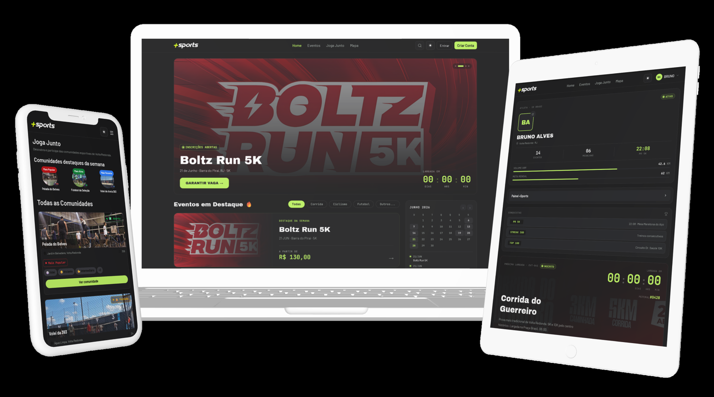

<p align="center">
  
</p>

<!-- <p align="center">
  Conectando praticantes de esportes aos espaços públicos da cidade.
</p> -->

<p align="center">
  
  
  
  
</p>

<!-- --- -->

## 📌 Sobre o projeto

O **+Sports** é uma aplicação Web que conecta a comunidade ao esporte na cidade, facilitando tanto a localização de quadras e praças disponíveis quanto a organização de partidas, treinos e eventos esportivos entre os próprios moradores. A proposta nasceu da dificuldade de encontrar informações sobre a infraestrutura esportiva local e de montar grupos para a prática de atividades físicas.

O projeto foi desenvolvido como trabalho acadêmico do curso de **Sistemas de Informação (UniFOA)**, seguindo a metodologia de Design Thinking, com etapas de pesquisa com usuários reais e testes de usabilidade.

🔗 **Demo online:** [Versão 2.0 - 2026.1](https://gabriel-lorenasi.github.io/maissports2.0/index.html)

## 🖥️ Preview

<p align="center">
  
</p>

## ⚙️ Funcionalidades principais

- 🗺️ **Mapa interativo** de quadras e espaços esportivos públicos, com filtros por modalidade e status
- 🏃 **Eventos esportivos** — inscrição, controle de vagas por lote e acompanhamento em "Meus Eventos"
- 🤝 **Joga Junto** — organização de partidas informais e confirmação de presença entre a comunidade
- 👤 **Perfis personalizados**, com histórico de atividades, conquistas e comunidades favoritas
- 🔐 **Autenticação** com perfis distintos para atleta, organizador de eventos e administrador

## 🛠️ Tecnologias utilizadas

O projeto combina páginas HTML com um servidor Node.js/Express para consultar os eventos por ID:

| Tecnologia | Uso no projeto |
|---|---|
| **HTML5** | Estruturação semântica das páginas |
| **Tailwind CSS v4** (via Play CDN) | Estilização e layout responsivo |
| **CSS3** | Animações e microinterações |
| **JavaScript (ES6+)** | Mapa customizado, cronômetros, controle de sessão, etc... |
| **Node.js / Express** | Rotas, controllers, middlewares e API de eventos |
| **Neon Postgres** | Persistência de eventos, organizadores e quadras adicionadas |
| **Figma** | Prototipagem |
| **Git & GitHub** | Versionamento e trabalho colaborativo |
| **GitHub Pages** | Hospedagem e publicação do site |

## 🗄️ Banco de dados

O servidor Express consulta eventos e organizadores no Neon Postgres. Configure
as variáveis `DATABASE_URL` (pool de conexões para a aplicação) e
`DATABASE_URL_UNPOOLED` (conexão direta usada pela migração), por exemplo com
`neon env pull`.

Depois, prepare o schema e carregue os dados iniciais dos arquivos JSON:

```bash
npm run db:migrate
npm run build
npm start
```

A migração é segura para executar novamente: ela cria as tabelas se necessário
e insere os registros iniciais sem substituir registros que já existam.

## 📍 Cadastro de quadras no mapa

### Por que essa adição foi feita

Antes, os locais do mapa eram mantidos diretamente no código da página. Para
cadastrar uma quadra, era necessário alterar os arquivos e publicar uma nova
versão. Agora, um administrador pode incluir o local pela própria interface;
os novos pins ficam no banco e aparecem para quem abrir o mapa depois.

Os pins iniciais de demonstração continuam definidos no código. Esta função
acrescenta novos locais persistidos no banco; ela ainda não edita nem remove os
locais existentes.

### Como funciona

1. O administrador entra na conta e abre **Mapa**.
2. Na lateral, clica em **Adicionar quadra** e depois clica no ponto desejado
   do mapa. O clique fornece latitude e longitude.
3. Preenche nome, esporte, tipo de local, status e endereço e salva.
4. O navegador envia os dados para `POST /api/quadras`, junto com o token da
   sessão. O servidor valida os campos e exige o perfil `admin` antes de
   gravar.
5. O local é salvo na tabela `sports_map_places` do Postgres e aparece no mapa.
   Nas próximas visitas, a página consulta `GET /api/quadras` para carregar os
   pins cadastrados.

O mapa aceita esportes de futebol society, futebol, vôlei, basquete, tênis,
padel, corrida, natação e ciclismo. Os status disponíveis são **Disponível**,
**Reserva** e **Completo**.

### Permissões

O perfil de administrador é definido no servidor pelos e-mails configurados
em `JWT_ADMIN_EMAILS`, separados por vírgula. A conta precisa existir e o
administrador deve entrar normalmente para receber um token. Como o cadastro
público não permite registrar um e-mail dessa lista, a conta admin deve ser
provisionada previamente. O botão da interface é exibido para essa sessão,
mas a permissão também é verificada pela API; alterar o `localStorage` no
navegador não concede acesso.

As rotas são:

| Método e rota | Acesso | Uso |
|---|---|---|
| `GET /api/quadras` | Público | Lista os pins cadastrados |
| `POST /api/quadras` | Administrador autenticado | Cria um pin |

O corpo do `POST` contém `title`, `sport`, `type`, `status`, `address`,
`latitude` e `longitude`. As coordenadas devem ser números válidos. A rota de
criação responde `401` sem token e `403` para uma conta que não seja admin.

### Como testar localmente

1. Configure um arquivo `.env` local, que não deve ser enviado ao Git, com:
   - `DATABASE_URL`: conexão Postgres para a aplicação;
   - `DATABASE_URL_UNPOOLED`: conexão direta usada para migrações;
   - `JWT_SECRET`: segredo com pelo menos 32 bytes;
   - `JWT_ADMIN_EMAILS`: e-mail da conta que será administradora.

   Para um projeto Neon já conectado, `neon env pull` pode preencher as
   variáveis de banco. Configure `JWT_SECRET` e `JWT_ADMIN_EMAILS` conforme o
   ambiente. Não compartilhe nem comite valores secretos.

2. Crie a tabela no banco:

   ```bash
   npm run db:migrate
   ```

   A migração cria `sports_map_places` se ela ainda não existir e pode ser
   executada novamente.

3. Inicie o servidor e abra a página:

   ```bash
   npm run dev
   ```

   Acesse `http://localhost:3000/mapa.html`, entre com a conta admin e siga o
   fluxo de cadastro descrito acima. Atualize a página para confirmar que o
   pin continua visível.

4. Rode as verificações automatizadas:

   ```bash
   npm test
   npm run build
   ```

Se a página informar que não conseguiu carregar os pins, confira se o servidor
está usando `DATABASE_URL` e se `npm run db:migrate` foi executado. A API e o
banco precisam estar disponíveis no servidor Express; uma hospedagem somente
estática, como GitHub Pages, não executa essas rotas.

## 🔐 Autenticação e usuários

O cadastro, login e endpoints CRUD de usuários são descritos no
[guia técnico de autenticação e usuários](./docs/autenticacao-e-usuarios.md),
incluindo rotas, fluxo com Neon, sessão no navegador e pré-requisitos do banco.

## 👥 Equipe

| Integrante |
|---|
| Júlio Cezar Barbosa de Souza |
| Gustavo Eduardo Silva |
| Davi Pereira Ramos | 
| Gabriel da Silva Lorena | 
| Vinicius Machado Robles de Santi | 

## 📄 Licença

Este projeto está sob os termos definidos no arquivo [LICENSE](./LICENSE).
