# 11. Design e Arquitetura

O design e a arquitetura do +Sports foram organizados para facilitar a descoberta de eventos, comunidades e espaços esportivos de Volta Redonda. A interface reúne essas informações em páginas com identidade visual comum, enquanto o servidor separa o recebimento das requisições, o controle das operações e o acesso aos dados.

## 11.1. Prototipação e identidade visual

Conforme a metodologia apresentada no resumo técnico, a equipe iniciou a prototipação no Figma e evoluiu para um protótipo funcional em HTML, CSS e JavaScript. As design sheets “Cronômetro - Dark Mode”, versão 1.0, orientaram a composição visual. A Figura 1 sintetiza essas referências e apresenta um wireframe documental da organização das telas, elaborado para esta seção a partir da implementação atual.

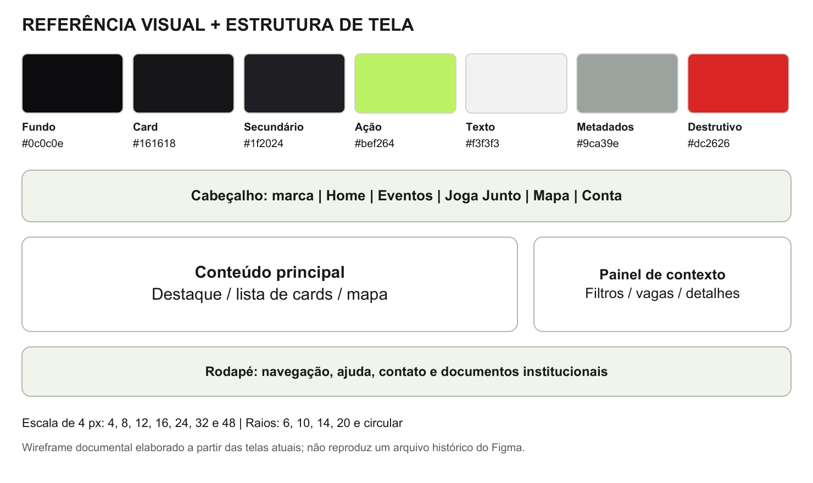

**Figura 1 - Síntese da identidade visual e wireframe da aplicação.**  
Fonte: elaboração a partir das design sheets fornecidas pela equipe e das telas desenvolvidas.

A composição combina superfícies escuras em escala zinc, texto claro e verde-lima para destacar ações e informações relevantes. A proporção 70/25/5 das sheets funciona como diretriz de distribuição entre superfícies, textos e destaques; o brilho fica concentrado em ações e marcadores ativos. Bordas discretas e espaçamentos em múltiplos de 4 px mantêm a unidade entre cards, botões e formulários.

Archivo Black estabelece a hierarquia dos títulos e JetBrains Mono destaca horários, valores e contadores. As sheets propõem Inter para textos corridos; nas páginas atuais, o token de corpo usa Barlow. Foco visível, rótulos e indicação textual dos estados orientam a acessibilidade. Essas diretrizes visuais não equivalem a uma validação integral de acessibilidade.

## 11.2. Telas desenvolvidas

As Figuras 2 a 9 apresentam recortes das telas atuais. As capturas foram realizadas com o servidor Express e banco PGlite isolado, usando os dados JSON do projeto. O perfil usa identificação fictícia. Os registros documentam a interface e não constituem comprovação de todos os fluxos em produção.

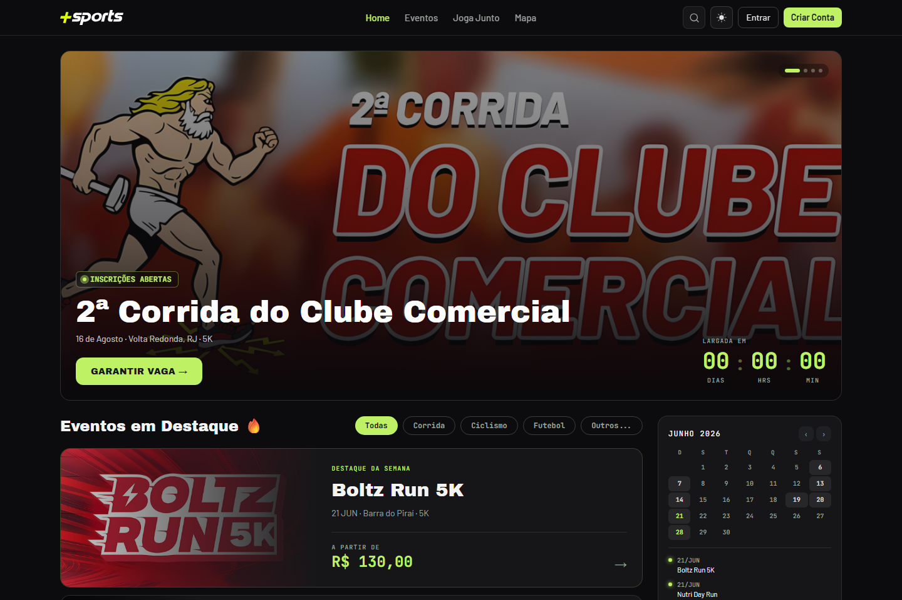

**Figura 2 - Página inicial: destaque de evento, navegação e conteúdo de descoberta.**  
Fonte: capturas da aplicação +Sports em ambiente local (18 nov. 2026).

A Figura 2 apresenta a Home, com cabeçalho comum, destaque principal e chamada para participação. A sequência de conteúdo direciona o visitante aos eventos e demais áreas. O verde-lima evidencia as ações prioritárias, enquanto datas e contadores usam tipografia monoespaçada.

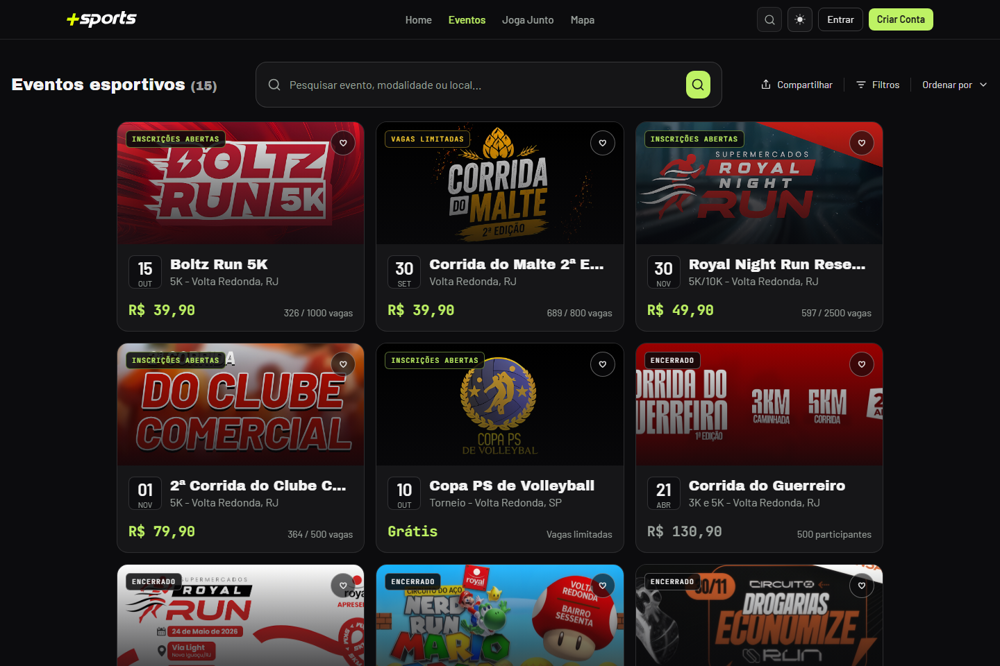

**Figura 3 - Catálogo de eventos com cards e controles de consulta.**  
Fonte: capturas da aplicação +Sports em ambiente local (18 nov. 2026).

Na Figura 3, os cards padronizam imagem, título, data, local, preço e vagas. A tela reúne pesquisa, filtros e ordenação na parte superior. A presença desses controles representa sua organização visual; nem todos estão integrados a uma consulta dinâmica no backend.

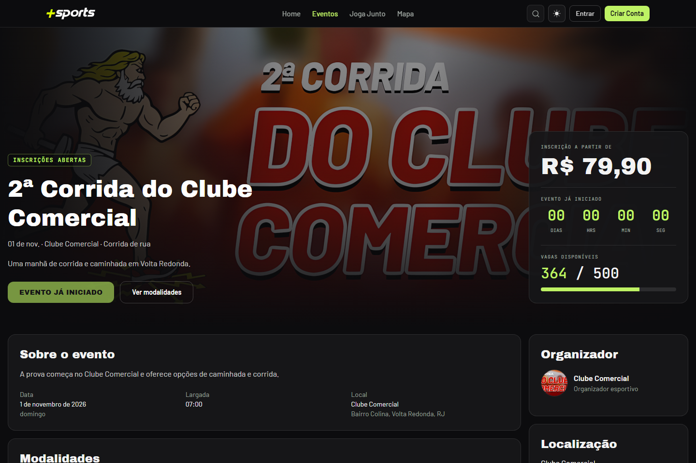

**Figura 4 - Detalhamento de evento consultado pela API.**  
Fonte: capturas da aplicação +Sports em ambiente local (18 nov. 2026).

A Figura 4 mostra a página compartilhada de detalhes, acessada por /evento/:id. O JavaScript consulta a API e preenche título, data, modalidades, valores, vagas, organizador e localização. A ação de inscrição depende do status, da data e das vagas. No evento capturado, a data já passou e o botão informa “Evento já iniciado”.

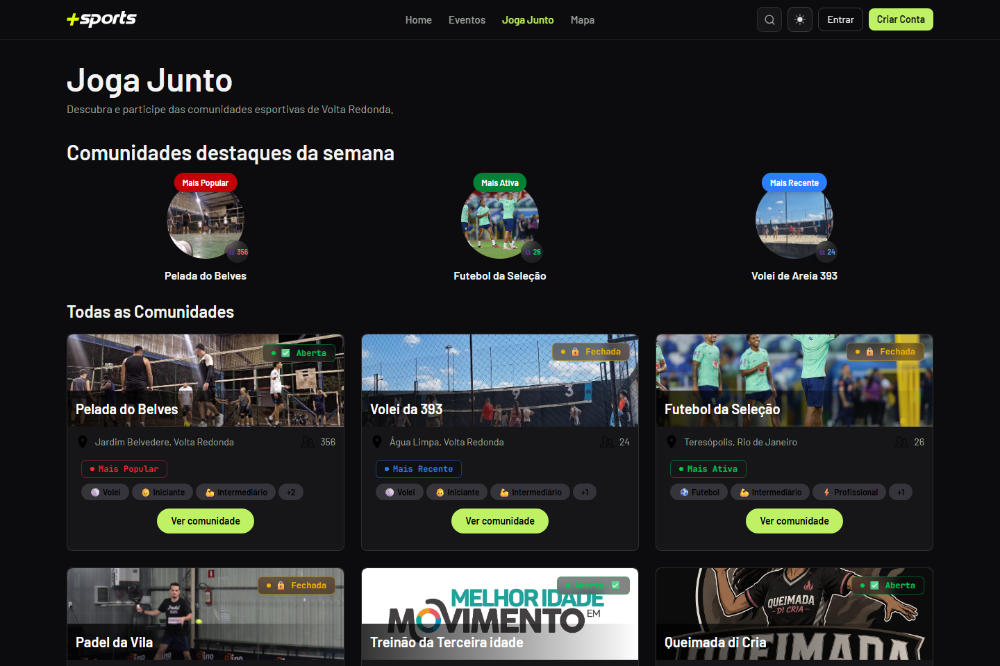

**Figura 5 - Joga Junto: descoberta de comunidades e atividades locais.**  
Fonte: capturas da aplicação +Sports em ambiente local (18 nov. 2026).

A Figura 5 apresenta a área Joga Junto. Comunidades em destaque antecedem a lista de grupos, cujos cards reúnem modalidade, imagem e estado da atividade. Os botões conduzem às páginas específicas das comunidades. O mapa é uma área própria da navegação atual; a integração entre mapa e Joga Junto permanece como direção apresentada nas sheets.

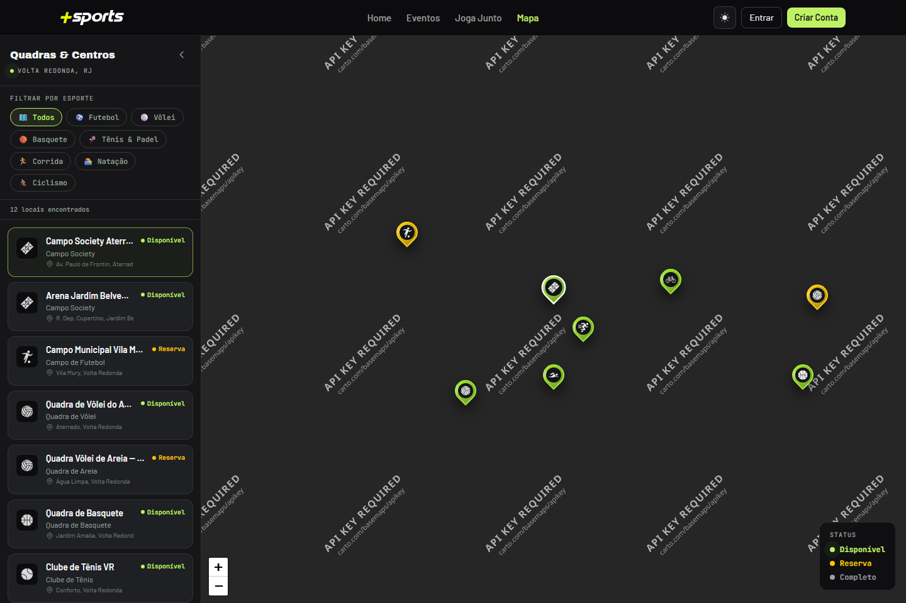

**Figura 6 - Mapa e lista de locais esportivos com marcadores por estado.**  
Fonte: capturas da aplicação +Sports em ambiente local (18 nov. 2026).

Na Figura 6, a lista de quadras e centros esportivos acompanha o mapa Leaflet. A seleção relaciona card e marcador, e os filtros de modalidade operam sobre os dados locais da página. Na captura, o provedor cartográfico retornou “API key required”; os marcadores e a lista aparecem sobre a base indisponível. Assim, a imagem registra uma dependência externa ainda a configurar.

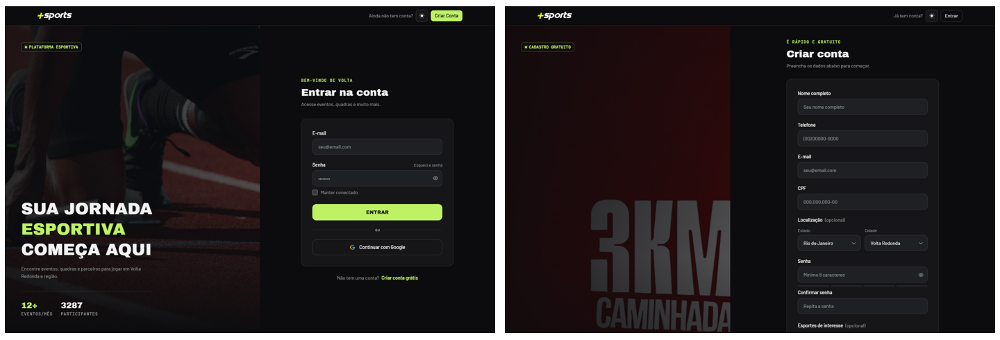

**Figura 7 - Telas de entrada (à esquerda) e criação de conta (à direita).**  
Fonte: capturas da aplicação +Sports em ambiente local (18 nov. 2026).

A Figura 7 evidencia a separação entre login e cadastro. Os formulários usam campos agrupados, rótulos e uma ação principal com destaque. A entrada solicita e-mail e senha; o cadastro reúne os dados pessoais e de acesso. Validações e mensagens próximas aos campos orientam o preenchimento. A visualização do cadastro é um recorte da página, cujo formulário continua abaixo.

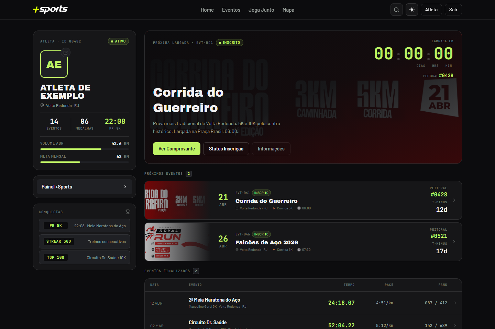

**Figura 8 - Perfil com identificação fictícia e painéis de acompanhamento.**  
Fonte: capturas da aplicação +Sports em ambiente local (18 nov. 2026).

A Figura 8 reúne identificação do atleta, próxima atividade e informações de acompanhamento. O nome foi inserido como dado fictício no navegador. Conquistas, inscrições e resultados visíveis incluem conteúdo demonstrativo; sua exibição não comprova persistência no banco. O estado local personaliza a interface, mas não representa autorização de acesso pelo servidor.

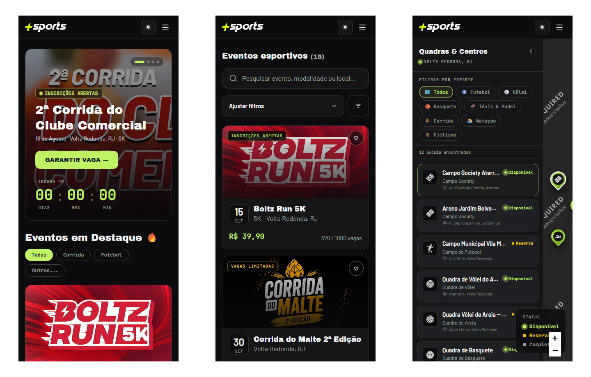

**Figura 9 - Home, catálogo de eventos e mapa em viewport de 390 × 844 px.**  
Fonte: capturas da aplicação +Sports em ambiente local (18 nov. 2026).

A Figura 9 apresenta a adaptação para dispositivos móveis. O menu é recolhido e os cards passam a ocupar uma coluna. No mapa, a lista lateral permanece visível e reduz a área cartográfica, aspecto que requer refinamento. As capturas representam esse tamanho de tela e não comprovam adaptação perfeita a todas as resoluções.

## 11.3. Fluxo de navegação

A navegação principal organiza o sistema em Home, Eventos, Joga Junto e Mapa, com entrada e cadastro em uma área específica de conta. A Figura 10 representa os percursos entre essas áreas e distingue a continuidade demonstrativa do fluxo de pagamento.

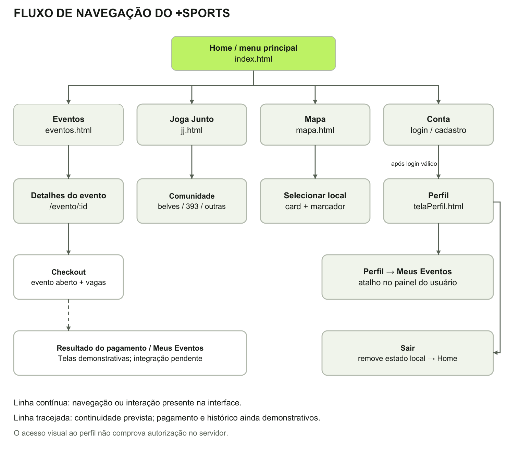

**Figura 10 - Fluxo de navegação e continuidade das ações do usuário.**  
Fonte: elaboração a partir dos links, rotas e comportamentos presentes no código do +Sports.

A descoberta de um evento conduz ao detalhamento; quando as condições permitem, a página oferece o acesso ao checkout. O caminho de conta contempla o envio das credenciais ao backend e o redirecionamento ao perfil após resposta válida. A saída remove o estado local e retorna à Home. Joga Junto conduz às páginas das comunidades, enquanto a interação com o mapa seleciona o local e seu card correspondente.

As telas de checkout, resultado de pagamento e Meus Eventos fazem parte da apresentação desenvolvida, mas ainda incluem dados e comportamentos demonstrativos. Por isso, a Figura 10 não apresenta esse trecho como uma inscrição persistida de ponta a ponta. As páginas de ajuda, contato, sobre, termos e privacidade complementam o acesso pelo rodapé.

## 11.4. Organização dos componentes e arquitetura técnica

A Figura 11 representa uma arquitetura em camadas, compatível com o MVC adaptado descrito no resumo. As páginas HTML constituem a apresentação; rotas e controllers conduzem as operações; repositórios concentram as consultas ao PostgreSQL. O Express também entrega os arquivos estáticos, e as páginas usam fetch nas operações integradas à API.

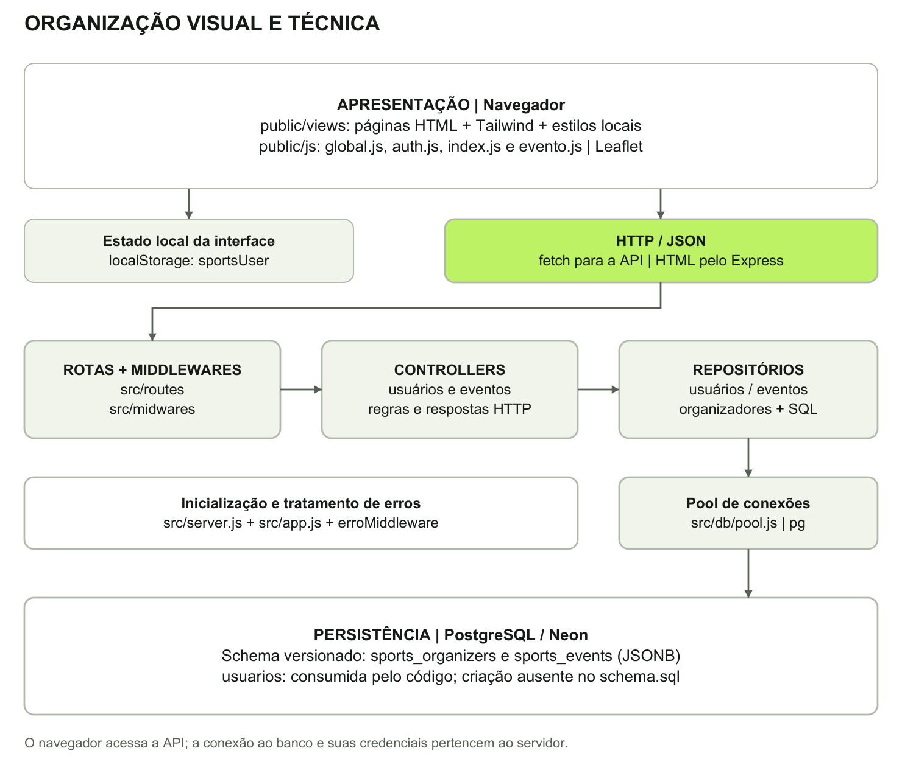

**Figura 11 - Camadas, componentes e comunicação entre navegador, servidor e banco.**  
Fonte: elaboração a partir da estrutura atual de public/ e src/ no repositório.

| Componente / localização | Responsabilidade |
| --- | --- |
| Cabeçalho, cards, formulários, mapa e rodapé | Padrões visuais repetidos nas páginas. Há HTML e estilos locais duplicados; o projeto ainda não possui uma biblioteca de componentes encapsulados. |
| public/js/ | global.js e auth.js: navegação, tema e estado local; index.js: interações da Home; evento.js: consulta e preenchimento do evento. |
| src/routes/ e src/midwares/ | Encaminhamento das URLs, validação de ID de evento e tratamento de erros. O nome midwares corresponde à pasta existente. |
| src/controllers/ e src/repositories/ | Controllers coordenam operações e respostas; repositórios executam SQL parametrizado para usuários, eventos e organizadores. |
| src/db/ e src/databases/ | Pool PostgreSQL, schema e migração; arquivos JSON fornecem os dados iniciais de eventos e organizadores. |

O schema versionado cria sports_events e sports_organizers, com dados em JSONB. A tabela usuarios é consumida pelo código, mas sua criação não consta nesse schema. O login verifica o hash com bcrypt; sportsUser no localStorage mantém somente estado de interface, sem sessão autenticada ou controle de papéis no servidor. Essas condições delimitam a arquitetura implementada e orientam sua evolução.

## Referências e escopo documental

- Resumo Técnico (1).pdf: seção 5, páginas 13-14, e seção 11, página 57.
- Design sheets +Sports “Cronômetro - Dark Mode”, versão 1.0, maio de 2026: seis imagens fornecidas na conversa. A Figura 1 é uma síntese elaborada para esta seção, não uma reprodução do arquivo do Figma.
- Código local consultado em 18/11/2026: public/views/, public/js/, src/app.js, src/server.js, src/routes/, src/controllers/, src/repositories/ e src/db/.
- Capturas em 1440 × 960 px e 390 × 844 px, com dados locais de teste. Não foram utilizadas credenciais ou registros do Neon.
- Os diagramas também estão disponíveis em SVG na pasta figuras/. A numeração das figuras é local a esta seção e pode ser ajustada ao integrar o texto ao relatório completo.
